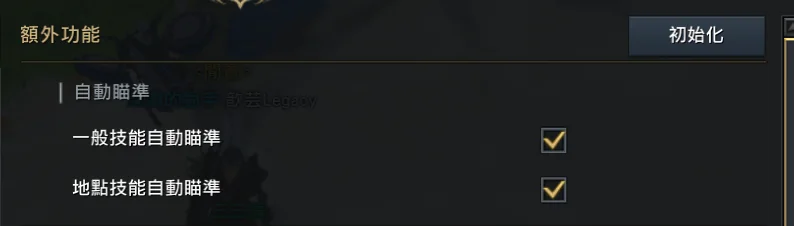
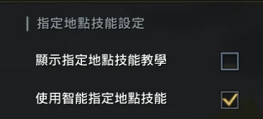
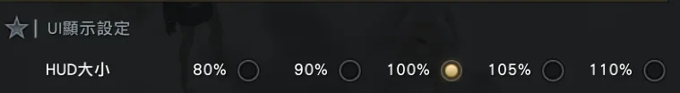
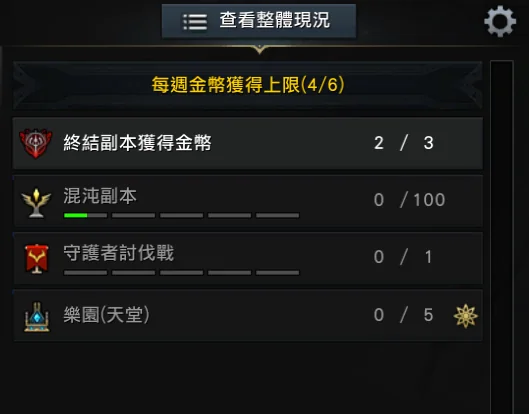

# Smart Hunter 使用手冊

Lost Ark (失落的方舟) 台版的自動化工具：每天一鍵打完所有角色的**每日混沌副本**、**樂園 (天堂)** 與**地獄**。自動切換角色、公會簽到 / 捐贈、領每週獎勵、進副本、照錄好的路線打完換下一隻。第一次用照「六步驟上手」做；之後遇到狀況，翻到最下面的[常見問題](#常見問題)。

- **適用**：Lost Ark 台版，Windows 10 / 11
- **費用**：註冊免費試用 3 天，之後付費使用
- **下載**：[Releases](https://github.com/sd016808/LostArkSmartHunterGUI/releases/latest) 最新版的 `SmartHunter_vX.X.X.zip`
- **圖文版手冊**：https://sd016808.github.io/LostArkSmartHunterGUI/ (同一份內容，有章節目錄、排版比較好看)
- **更新紀錄**：[CHANGELOG.md](CHANGELOG.md)，每一版改了什麼 (程式的「帳號」分頁也有連結)
- **作者**：吃泡麵度年的SD

## 六步驟上手

1. **下載並解壓縮**：整包 zip 解壓到同一個資料夾 → [安裝](#安裝)
2. **安裝 ViGEmBus**：虛擬搖桿驅動，只要裝一次 → [安裝](#安裝)
3. **註冊試用**：開程式按「註冊」，免費 3 天 → [註冊與登入](#註冊與登入)
4. **調好遊戲設定**：自動瞄準、HUD 100%、小地圖 100% 等五項 → [遊戲內設定](#遊戲內設定)
5. **設定角色**：在「設定」分頁填要打的角色 → [設定角色](#設定角色)
6. **開遊戲，按 <kbd>Ctrl</kbd>+<kbd>F10</kbd>**：一隻一隻角色自動打完 → [開始任務](#開始任務)

## 目錄

- **第一次使用**：[安裝](#安裝) · [註冊與登入](#註冊與登入) · [遊戲畫面設定](#遊戲畫面設定) · [遊戲內設定](#遊戲內設定) · [設定角色](#設定角色)
- **每天使用**：[開始任務](#開始任務) · [快捷鍵](#快捷鍵) · [看結果](#看結果)
- **需要幫忙時**：[回報問題與遠端協助](#回報問題與遠端協助) · [帳號與續費](#帳號與續費) · [常見問題](#常見問題) · [注意事項](#注意事項)

---

## 安裝

1. **下載**：到 [Releases 頁面](https://github.com/sd016808/LostArkSmartHunterGUI/releases/latest) 下載最新版的 `SmartHunter_vX.X.X.zip`。
2. **解壓縮**：整個 zip 解壓縮到同一個資料夾，例如 `D:\SmartHunter`。`LostArkSmartHunter.exe`、所有 `.dll` 和 `Routes` 資料夾要放在一起，只拷 exe 開不起來。
3. **安裝 ViGEmBus**：到 [ViGEmBus Releases](https://github.com/nefarius/ViGEmBus/releases) 下載安裝檔安裝，裝完重開機。程式用它模擬 Xbox 搖桿來操作角色，只要裝一次。
4. **執行**：雙擊 `LostArkSmartHunter.exe`。Windows 會問「是否允許此 App 變更您的裝置」，按「是」。遊戲只接受系統管理員權限程式送出的按鍵，所以每次開都會問。

> **第一次執行跳出「Windows 已保護您的電腦」？** 按「其他資訊」再按「仍要執行」。不需要另外安裝 .NET。

## 註冊與登入

第一次打開會看到登入畫面。切到「註冊 (免費試用 3 天)」，填 email 和密碼 (至少 8 個字)，按「註冊並開始試用」就會直接進主畫面。

- **一台電腦只有一次免費試用**。同一台電腦再註冊新帳號，帳號會建立，但要付費才能使用。
- **記住登入**：之後開程式會直接進主畫面，不用再打密碼；按右上角「登出」才會忘記。
- **同一個帳號同時只能在一台電腦使用**。在另一台電腦登入，原本那台會被登出，正在跑的任務也會停。
- **忘記密碼**：登入畫面切到「忘記密碼」，填 email 按「寄驗證碼到這個 email」，把信裡的 6 位數驗證碼 (15 分鐘內有效) 和新密碼填進去就好。沒收到先看垃圾信件夾。驗證碼一小時最多寄 3 次，輸錯 5 次要重寄。

## 遊戲畫面設定

程式是「看」遊戲畫面來判斷現在在哪、要按什麼，所以遊戲畫面要讓它看得清楚。開始任務前確認一次：

- [ ] **解析度是 16:9、至少 1920×1080**：1920×1080、2560×1440、3840×2160 都可以；16:10 等其他比例不支援
- [ ] **遊戲用「視窗」或「無邊框視窗」**：程式畫在遊戲上的標記 (紅圈、箭頭) 只有這兩種模式看得到
- [ ] **遊戲畫面沒被其他視窗擋住，也沒縮到工作列**：視窗模式時，工作列不要蓋到遊戲畫面下緣
- [ ] **任務進行中不動滑鼠、不調整遊戲視窗大小**：游標擋到要辨識的地方時，程式會自己把游標移到畫面左邊
- [ ] **遊戲內設定五項都調好了**：自動瞄準、指定地點技能、HUD 100%、小地圖 100%、角色列表面板，見下一章
- [ ] **程式跟遊戲誰先開都可以**：遊戲重開、切帳號、換解析度，程式都不用重開；按開始時才會去找遊戲視窗

## 遊戲內設定

下面五項是遊戲裡的設定，一定要照著調，程式才看得懂畫面、技能才打得到怪。前三項在遊戲的設定選單裡，照截圖上的分類標題找。

### 1. 自動瞄準

| 設定 | 調成 |
|---|---|
| 一般技能自動瞄準 | **勾** |
| 地點技能自動瞄準 | **勾** |

在「額外功能」→「自動瞄準」。程式用虛擬搖桿放技能，要靠自動瞄準才會對準怪。



### 2. 指定地點技能

| 設定 | 調成 |
|---|---|
| 使用智能指定地點技能 | **勾** |
| 顯示指定地點技能教學 | **不勾** |

在「指定地點技能設定」。勾了智能指定，地點技能會直接放出去，不會停下來等人選位置；教學不勾，才不會跳出視窗擋住畫面。



### 3. HUD 大小

| 設定 | 調成 |
|---|---|
| HUD大小 | **100%** |

在「UI顯示設定」。程式找按鈕和介面的位置，是照 HUD 100% 的大小量的，調大調小都會找不到。



### 4. 右上角的小地圖

| 設定 | 調成 |
|---|---|
| 縮放 | **100%** |
| 透明度 | **100%** |

程式靠小地圖認出角色在副本裡的位置，縮放或透明度不一樣，就對不上錄好的路線。

### 5. 角色列表右邊的面板

| 項目 | 調成 |
|---|---|
| 混沌副本 | **要顯示** |
| 樂園(天堂) | **要顯示** |

ESC →「立即使用其他角色登入」，右邊這個面板。用面板右上角的齒輪設定要顯示的項目，「混沌副本」和「樂園(天堂)」都要出現，順序沒關係。程式從這裡讀每隻角色還剩幾次；沒顯示的話讀不到，角色會被當成沒有次數而全部跳過。



## 設定角色

「設定」分頁決定每日任務要打哪些角色、打哪個副本。改完按「儲存」，下一次開始任務時生效，不用重開程式。設定存在程式資料夾的 `settings.json`，分頁裡的「用記事本開啟」可以直接改。

### slot 是角色在列表裡的位置

遊戲裡 ESC 選單的「立即使用其他角色登入」會列出所有角色。slot 就是角色在這個列表的位置：**從左到右、從上到下**數，第一排是 1、2、3，第二排 4、5、6，以此類推，最多 30 隻。超過 9 隻時程式會自己捲動列表。

```
 1   2   3
 4   5   6
 7   8   9
```

多個帳號可以共用同一份設定：slot 照角色最多的那個帳號填，角色比較少的帳號沒有的 slot 會自動略過。

### 每隻角色要打的副本

- 下拉選「自動」、「涅夫塔1作戰」、「亞比都斯3作戰」、「亞比都斯2作戰」或「亞比都斯1作戰」。
- **自動**：依序找 涅夫塔1 → 亞比都斯3 → 亞比都斯2 → 亞比都斯1，打第一個能進的；都不能打就只做公會簽到。
- 混沌副本次數 **100 以上** 的角色才會進副本，不夠的角色直接跳過、不登入。
- 不想打的角色按「移除」；要加角色按「+ 加一隻角色」。
- **公會**：每隻角色一定會簽到；勾「公會簽到後順便捐贈銀幣」才會捐。
- **打完自動關遊戲**：勾了的話，所有角色處理完會從 ESC 選單關閉遊戲。中途失敗不會關。

### 地獄與其他設定

- **地獄寶箱順序**：打完要開哪個寶箱，照順序挑畫面上第一個有的，用「、」隔開，例如 `特殊提煉、綁定金幣、融合`。名稱裡有這幾個字就算符合，寫 `7階段特殊提煉寶箱` 就只要 7 階段的。留空 = 預設順序 (特殊提煉 > 綁定金幣 > 融合 > 天堂 > 破壞石 > 提煉輔助 > 星石 > 碎片 > 命運之石 > 能力石 > 手環)。
- **地獄要打的角色**：預設跟每日任務一樣；取消勾選「地獄打的角色跟上面每日混沌副本相同」就能另外設定，每隻也可以有自己的寶箱順序。
- **角色名字白名單** (選填)：一行一個角色名字，只用來修正統計報表裡辨識錯的名字。
- **重播停留**：一般不用改。
- **滑鼠游標**：游標擋到要辨識的畫面時程式會把它移到畫面左邊；這裡填最少隔幾秒才再檢查一次，0 = 每次截圖前都檢查 (預設)。覺得滑鼠太常被移走可以填 5 或 10，但游標擋在結算畫面的按鈕上程式會看不到通關，數字越大風險越高。

## 開始任務

開好遊戲、角色站在城裡或任何安全的地方，按「主控」分頁的按鈕或快捷鍵開始。三種任務同時只能跑一種。

### 每日混沌副本

<kbd>Ctrl</kbd>+<kbd>F10</kbd>，或主控分頁的「開始 每日混沌副本」。

1. 照 slot 順序切換角色，次數不到 100 的跳過
2. 公會簽到，有勾就捐贈銀幣
3. 領每週淨化任務獎勵，進混沌副本，照錄好的路線打完
4. 全部完成會發出提示音，有勾就關遊戲

中途停掉再按一次會從頭跑：已經打過的角色次數扣掉了，會直接跳過。

### 樂園 (天堂)

<kbd>Ctrl</kbd>+<kbd>F8</kbd>，或主控分頁的「開始 樂園」。

1. 跟每日任務用同一份角色；樂園次數是 0 的角色跳過
2. 戰況板 → 樂園 → 天堂，選能打的最高階段入場
3. 自動放技能、往怪靠過去，打完全部次數
4. 出現「離開」就離開，換下一隻

只打樂園，不做公會簽到和混沌副本。

### 地獄

<kbd>Ctrl</kbd>+<kbd>F5</kbd>，或主控分頁的「開始 地獄」。

1. 每隻角色都會登入 (角色列表看不到地獄次數)
2. 選鑰匙入場：綠 > 白 > 橘 > 紫 > 藍，奈落鑰匙不用
3. 每層清怪、使用祭壇 (只放藍色鑰匙)，找互動點往下跳，綠色「孤注一擲」優先
4. 打完照寶箱順序開一個寶箱，按「再次挑戰」繼續，沒鑰匙就換下一隻

每一場到過哪些樓層、開了什麼寶箱都會記錄下來。

### 暫停、停止與其他操作

- **暫停 / 繼續**：任務中按 <kbd>F10</kbd> (或「暫停」按鈕) 就可以自己操作角色，再按一次 <kbd>F10</kbd> 繼續。
- **停止**：再按一次同一個快捷鍵，或按變成紅色的「停止 …」按鈕。程式會先做完手上的動作再停，可能要等幾秒。
- **換任務**：一個任務在跑時，按另一個任務的快捷鍵不會動作，要先停掉原本的。
- **遊戲上的標記**：紅圈 = 認到的怪、箭頭 = 往哪走；地獄裡綠框 G = 綠色「孤注一擲」、黃框 W = 一般的往下跳互動點。只有視窗或無邊框模式看得到，錄影也錄不到。

## 快捷鍵

主控分頁的按鈕跟快捷鍵是同一件事。遊戲在前景時用快捷鍵比較方便，不用切回程式。

| 按鍵 | 功能 |
|---|---|
| <kbd>Ctrl</kbd>+<kbd>F10</kbd> | 開始 / 停止 每日混沌副本 |
| <kbd>Ctrl</kbd>+<kbd>F8</kbd> | 開始 / 停止 樂園 (天堂) |
| <kbd>Ctrl</kbd>+<kbd>F5</kbd> | 開始 / 停止 地獄 |
| <kbd>F10</kbd> | 任務進行中：暫停 / 繼續 |
| <kbd>Ctrl</kbd>+滑鼠滾輪 | 在程式視窗裡：放大 / 縮小程式畫面 (<kbd>Ctrl</kbd>+<kbd>0</kbd> 回到 100%) |

## 看結果

主控分頁左邊的「狀態」顯示現在在做什麼，右邊是執行紀錄。每日任務結束時 (完成、失敗或手動停止都會)，左邊會出現每隻角色的結算表，並在程式資料夾的 `reports` 產生一份戰報網頁，按「開啟 reports 資料夾」就找得到，用瀏覽器打開，不用網路。

戰報裡有：

- 今日結算：每隻角色的副本、結果、時間、死亡次數、片鱗、公會簽到 / 捐贈，破本月最快會標出來
- 近 30 天每張地圖的通關時間趨勢
- 本月各地圖的場數、平均 / 最快 / 最慢時間
- 死亡位置：在路線地圖上標出每次死掉的地方
- 片鱗：每隻角色今天 / 本月出現幾個，分命運與祝福
- 樂園：今天每隻角色打的階段與場數 (樂園任務結束時也會產生戰報)

結算表大概長這樣 (範例資料，★ = 這張地圖本月最快)：

| 角色 | 副本 | 結果 | 時間 | 死亡 | 片鱗 |
|---|---|---|---|---|---|
| 角色A | 涅夫塔1作戰 | 通關 | 3:12 | 0 | 1 |
| 角色B | 涅夫塔1作戰 | 通關 | 2:58 ★ | 0 | 0 |
| 角色C | 亞比都斯3作戰 | 逾時 | 6:00 | 1 | 0 |
| 角色D | 亞比都斯2作戰 | 通關 | 3:40 | 1 | 2 |

> **為什麼會「逾時」？** 一場副本超過 6 分鐘還沒看到結算畫面，程式會當作結束、換下一隻角色，當下的畫面存在 `logs` 資料夾。常見原因是滑鼠擋在結算畫面的按鈕上，或角色卡在地形。

## 回報問題與遠端協助

### 送出回報

到「協助」分頁，寫下發生什麼事 (哪個任務、第幾隻角色、大概幾點)，按「送出回報」。程式會把最近 7 天的執行紀錄、失敗時的截圖、設定和統計紀錄打包傳給作者。**不會傳遊戲帳號密碼。**

### 遠端協助

需要作者直接看畫面時，按「請作者遠端協助」，作者會收到通知，在瀏覽器看到你**整個螢幕** (不只遊戲)。

- 預設只能看；勾「允許遙控」作者才能操作你的滑鼠鍵盤。
- 處理完按「結束協助模式」或關掉程式，所有連線就會中斷。
- 每次連線的時間和來源都記在 `logs\remote_connections.log`。

### 聯絡作者

- **Discord**：`sd_peko`
- **Email**：sd016808@gmail.com

## 帳號與續費

剩幾天顯示在程式右上角，顏色代表狀態；詳細的到期日在「帳號」分頁。

| 右上角的標籤 | 意思 |
|---|---|
| 綠色「試用 剩 3 天」 | 正常 |
| 黃色「付費 剩 6 天」 | 7 天內到期 |
| 紅色「付費 剩 2 天」 | 3 天內到期 |
| 黃色「連不上授權伺服器」 | 網路斷線中 |

### 續費

1. 在 Discord 私訊作者，問付款方式
2. 付款後，把你的帳號 (註冊的 email) 告訴作者
3. 作者在後台幫你延長
4. 1 分鐘內自動生效，不用重開程式

### 到期、斷線與被登出

- **到期時**：正在跑的任務會讓它跑完；之後不能開始新任務，主控分頁會顯示紅字。任務結束後回到登入畫面。續費後不用重新安裝或重開。
- **網路斷線或伺服器暫時連不上** (作者更新伺服器時也會短暫出現)：任務照跑，30 分鐘內恢復就沒事；超過 30 分鐘才會回到登入畫面。
- **「此帳號已在其他地方登入」**：同一個帳號只能在一台電腦用。如果不是你自己在別台登入，請用「忘記密碼」改密碼。

## 常見問題

<details>
<summary><b>角色全部被跳過，說混沌副本次數不夠或樂園沒有次數</b></summary>

角色列表右邊的面板沒有顯示「混沌副本」或「樂園(天堂)」，程式讀不到剩餘次數。照 [遊戲內設定](#遊戲內設定) 第 5 項，用面板右上角的齒輪把這兩項顯示出來。

</details>

<details>
<summary><b>技能常常放空，沒打到怪</b></summary>

檢查 [遊戲內設定](#遊戲內設定) 的「一般技能自動瞄準」、「地點技能自動瞄準」、「使用智能指定地點技能」有沒有都勾。

</details>

<details>
<summary><b>按了開始沒反應，顯示「找不到 LOSTARK 視窗」</b></summary>

遊戲還沒開、還在讀取，或被縮到工作列了。等遊戲畫面出來、角色可以動之後再按一次。

</details>

<details>
<summary><b>顯示「虛擬搖桿連接失敗」</b></summary>

ViGEmBus 沒裝或還沒準備好。到 [安裝](#安裝) 第 3 步裝 ViGEmBus，裝完重開機。剛開機時驅動可能晚一點才好，等一下再按主控分頁的「重試」。

</details>

<details>
<summary><b>註冊後說「這台電腦已經用過免費試用」</b></summary>

一台電腦只有一次試用。帳號已經建好了，付費後就能用，續費方式見 [帳號與續費](#帳號與續費)。

</details>

<details>
<summary><b>用到一半被登出，說「此帳號已在其他地方登入」</b></summary>

同一個帳號在別台電腦登入了。如果不是你，請馬上用登入畫面的「忘記密碼」改密碼。

</details>

<details>
<summary><b>登入時說「密碼錯誤太多次，暫停登入」</b></summary>

密碼連續輸錯 5 次會暫停登入 15 分鐘，畫面上會寫幾點之後可以再試；暫停期間就算密碼打對也進不去，之後再連續輸錯會停更久。想不起密碼就用登入畫面的「忘記密碼」重設，重設好馬上可以登入。已經登入、正在用的程式不受影響。

如果畫面說的是「這個網路位址密碼錯誤太多次」，是你所在的網路 (例如同一個手機熱點) 在 10 分鐘內猜錯太多次，等 15 分鐘再試，或換個網路。

</details>

<details>
<summary><b>主控分頁出現黃色的公告，或紅字說「管理員已暫停所有人的任務」、「這個版本太舊」</b></summary>

黃色框是作者的公告，看一下就好。紅字「管理員已暫停所有人的任務」通常是遊戲改版讓工具暫時不能用，正在跑的任務會被停掉；作者修好解除後程式會自動恢復，不用重開。紅字說「這個版本太舊」就到「帳號」分頁按「檢查更新」裝新版，正在跑的任務會讓它跑完，之後要更新才能再開始。

</details>

<details>
<summary><b>出現「連不上授權伺服器」</b></summary>

多半是網路斷了，或作者正在更新伺服器 (通常幾分鐘)。任務會照跑，30 分鐘內恢復就自動回到正常，不用做任何事；超過 30 分鐘才會回到登入畫面，網路好了再登入即可。

</details>

<details>
<summary><b>任務卡住不動了</b></summary>

按 <kbd>F10</kbd> 暫停，自己把角色帶到正常的地方，再按 <kbd>F10</kbd> 繼續；或按同一個任務的快捷鍵停止，重新開始。

再發生的話，到「協助」分頁[送出回報](#回報問題與遠端協助)，寫下是哪個任務、第幾隻角色、大概幾點。

</details>

<details>
<summary><b>主控分頁的紀錄出現「遊戲視窗不在支援範圍」</b></summary>

遊戲解析度不是 16:9 或小於 1920×1080。到遊戲設定改成 1920×1080 或 2560×1440 等 16:9 解析度，改完不用重開程式。

</details>

<details>
<summary><b>程式的字太大、視窗超出螢幕</b></summary>

按右上角的「－」，或按住 <kbd>Ctrl</kbd> 滾滑鼠滾輪縮小。視窗大小和縮放會記住，下次開一樣。

</details>

<details>
<summary><b>在設定頁改了東西但沒生效</b></summary>

改完要按「儲存」。設定在開始任務時才讀，正在跑的任務不會變，下次開始才生效。

</details>

<details>
<summary><b>程式說有新版本，要不要更新？</b></summary>

建議更新。登入後程式會自己檢查，有新版會跳出更新內容；任務進行中請先停止再更新。你的設定和登入狀態不會被覆蓋。

</details>

<details>
<summary><b>好幾個遊戲帳號可以共用同一份設定嗎？</b></summary>

可以。slot 照角色最多的那個帳號填，角色比較少的帳號沒有的 slot 會自動略過，也不會出現在結算表。

</details>

## 注意事項

> **使用風險**：使用任何自動化工具都可能違反遊戲的服務條款，請自行評估風險，使用後果由使用者自行承擔。

- 程式資料夾裡的 `settings.json` 是你的設定，`logs` 是執行紀錄，`reports` 是戰報，`stats` 是每場的統計紀錄。搬資料夾時整個一起搬。
- 想自己用手機看電腦畫面，請用作者的另一個免費程式 [SmartRemote](https://github.com/sd016808/SmartRemote)；本程式的遠端協助只給作者排查問題用。
- 角色名字、混沌副本次數、副本名稱的文字辨識使用 [PaddleOCR](https://github.com/PaddlePaddle/PaddleOCR) 的 PP-OCRv5 模型 (Apache License 2.0)。

## 支持作者

如果這個工具有幫你省下時間，想請作者喝杯咖啡，或有問題、建議想回報，歡迎透過以下方式聯繫：

- **Discord**：`sd_peko`
- **Email**：sd016808@gmail.com
